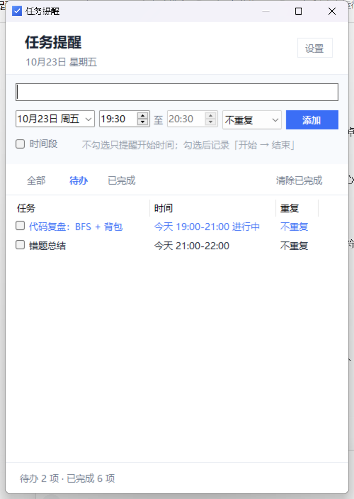
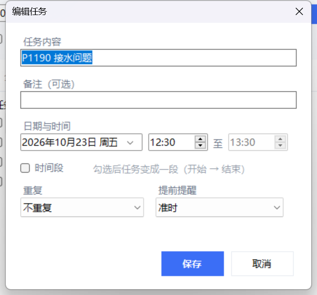

# 任务提醒（Task Reminder）

[English](README.md) | **简体中文**

一个零依赖、纯本地、常驻系统托盘的 Windows 任务提醒工具。到点弹出提醒卡片，没做完会隔一会儿再催一次，重复任务自动排下一次，还能开机自启——全部由一个 PowerShell 脚本实现：免安装、无账号、不联网、不收集任何数据。



## 为什么又做一个待办

- **零依赖**：Win10 / Win11 自带 Windows PowerShell 5.1 和 WinForms，不用装运行时，也没有更新弹窗。
- **纯本地**：所有任务存在脚本旁边的一个 JSON 文件里，人能直接读懂。备份 = 复制文件夹，卸载 = 删除文件夹。
- **为"14:30 提醒我"而生，不是项目管理软件**：分钟级时间、时段、稍后提醒、重复规则、提前提醒。
- **重启还在**：登录时通过启动文件夹的快捷方式静默拉起。

## 截图

| 提醒卡片 | 编辑任务 |
| --- | --- |
|  |  |

## 功能

| 功能 | 说明 |
| --- | --- |
| 到点提醒 | 每 10 秒检查一次，右下角弹出置顶提醒卡片，可带提示音 |
| 分钟级时间 | 直接输入 `14:37` 或滚动选择，不会静默回退到错误时间 |
| 时段任务 | 可设开始 → 结束，列表显示 `12:30-13:30`；结束前状态为**进行中**，过了结束时间才算**逾期** |
| 稍后提醒 | 提醒卡片上 10 分钟；右键菜单 10 / 30 分钟 |
| 提前提醒 | 准时 / 5 / 10 / 15 / 30 分钟 / 1 小时 / 2 小时 / 1 天 |
| 重复任务 | 不重复、每天、每周、每月、工作日；完成后自动排下一次 |
| 催办 | 没完成的任务按 10 / 15 / 30 / 60 分钟（默认 15）再次提醒，可关闭 |
| 快速添加 | 输入任务内容按 `Enter` 即可 |
| 逾期可见 | 逾期行标红，底部统计逾期数量 |
| 开机自启 | 启动文件夹快捷方式 → `wscript` → 隐藏窗口的 PowerShell，不闪黑框 |
| 单实例 | 命名互斥量，重复启动只会把已有窗口拉到前面 |
| 存档安全 | 原子替换 + 失败重试 + `.old` 回滚副本；损坏的 JSON 自动备份为 `tasks.json.broken-<时间戳>` |

## 环境要求

- Windows 10 / 11
- Windows PowerShell 5.1（系统自带）。不需要 Node.js、Python、.NET SDK，也不需要管理员权限。

## 快速开始

1. 下载 ZIP（或 `git clone`），解压到任意目录，例如 `%USERPROFILE%\Documents\TaskReminder`。
   **整个文件夹要一起保留**：程序按自身位置查找 `data\`、`app.ico` 和 `.vbs` 启动器。
2. 双击 **`Start-TaskReminder.vbs`**。主界面弹出，托盘出现图标。
3. *可选* —— 创建桌面和开机启动快捷方式：

```powershell
powershell -ExecutionPolicy Bypass -File .\TaskReminder.ps1 -Setup
```

### 日常使用

- **添加** —— 顶部输入任务内容，选日期 / 时间 / 重复，按 `Enter` 或点「添加」。
- **完成** —— 勾选左侧复选框。点行内文字只会选中该行，不会误勾完成。
- **编辑** —— 双击任意一行，可改时间、写备注、设提前提醒。
- **稍后提醒 / 顺延** —— 右键一行：10 分钟后再提醒、30 分钟后再提醒、顺延 10 分钟、顺延到明天 09:00、删除。
- **关闭窗口** —— 只是隐藏到托盘，程序继续运行；真正退出请用托盘图标右键菜单。
- **设置** —— 右上角「设置」：提示音、关闭按钮行为、催办间隔、开机自动启动。

## 开机自启

`-Setup`（或「设置」里的「开机自动启动」）会写入
`%APPDATA%\Microsoft\Windows\Start Menu\Programs\Startup\任务提醒.lnk`，指向
`wscript.exe Start-TaskReminder.vbs -StartHidden`。用 `wscript` 是为了不闪控制台窗口，PowerShell 以 `-WindowStyle Hidden -ExecutionPolicy Bypass` 运行。

本仓库预置了 `data\settings.json`（其中 `"Launched": 1`），所以**新克隆的副本不会偷偷把自己加进启动项**；需要自启请在设置里勾选，或运行 `-Setup`。如果删掉 `data\settings.json`，程序内置的首次运行行为会自动启用自启。

## 目录结构与数据格式

```
Task Reminder/
├─ TaskReminder.ps1          整个程序（PowerShell + WinForms，单文件）
├─ Start-TaskReminder.vbs    静默启动器（不弹控制台）
├─ app.ico                   托盘 / 桌面图标
├─ data/
│  ├─ tasks.json             你的任务（UTF-8 JSON）
│  ├─ settings.json          偏好设置
│  └─ app.log                诊断日志（可随时删除）
└─ docs/                     本 README 用到的截图
```

一条任务长这样：

```json
{
  "id": "7c44fa575c284f9bac34b4fa65b2a5ba",
  "title": "站会",
  "note": "带上发版说明",
  "due": "2026-10-23T09:30:00",
  "end": "2026-10-23T10:00:00",
  "repeat": "weekday",
  "lead": 10,
  "done": false,
  "doneAt": null,
  "notified": false,
  "snoozeUntil": null,
  "createdAt": "2026-10-22T20:15:10",
  "completedCount": 3,
  "lastAlert": null
}
```

`due` / `end` 是本地时间，格式 `yyyy-MM-ddTHH:mm:ss`；`end` 可以为 `null`（单点时刻任务）。
`repeat` 取值 `none` / `daily` / `weekly` / `monthly` / `weekday`；`lead` 是提前多少分钟提醒。

## 命令

| 命令 | 作用 |
| --- | --- |
| `Start-TaskReminder.vbs` | 静默启动（快捷方式用的就是它） |
| `-Setup` | 创建桌面 + 开机启动快捷方式，并启用自启 |
| `-RemoveShortcuts` | 删除两个快捷方式（程序本体保留） |
| `-SelfTest` | 跑 28 条内置逻辑断言（重复规则、到点判定、稍后提醒、JSON 往返），退出码 0/1 |
| `-Preview` | 显示一张示例提醒卡片，约 14 秒后自动退出 |
| `-StartHidden` | 隐藏启动到托盘（开机启动快捷方式使用） |

```powershell
# 逻辑自检
powershell -NoProfile -ExecutionPolicy Bypass -File .\TaskReminder.ps1 -SelfTest
```

## 常见问题

**开机后没看到界面。** 它是隐藏启动的，请看托盘里的蓝色对勾图标（可能收在 `^` 溢出区里），双击即可打开窗口。

**提醒卡片被挡住。** 卡片是置顶窗口，但钉在右下角的桌面宠物 / 小组件可能压在它上面，移开或关掉小组件即可。

**杀毒软件报 PowerShell。** 程序是未签名的 `.ps1`，又以 `-ExecutionPolicy Bypass` 启动，会命中部分启发式规则。整个程序就是一个可读脚本，可以自行审阅；也可以 `Unblock-File .\TaskReminder.ps1` 解除文件锁定。

**提示"任务提醒已经在运行了"。** 设计上只允许单实例，再启动会把已有窗口带到前面。

**任务会不会丢。** 每次改动立即落盘；文件被 OneDrive 或杀毒临时占用时会重试 5 次，失败会明确提示。JSON 损坏会先备份成 `tasks.json.broken-<时间戳>` 再忽略；文件缺失时，启动会自动从上一次的 `.old` 副本恢复。

## 已知限制

- 界面不声明 DPI 感知，在 150% 缩放下由系统拉伸，看起来偏软。
- 每月重复按上一次日期推算，31 号的任务到 2 月会变成 28 号，之后一直在 28 号。
- 界面与托盘提示只有中文。
- 没有云同步、没有手机端（有意为之）。

## 版本记录

**v1.4** —— 原子存档 + 重试 + 回滚；修复"稍后提醒"与提前提醒叠加触发的问题；取消勾选完成会重新武装提醒；编辑或顺延已完成任务会把它变回待办；添加区默认时间不再冻结在启动时刻；托盘"开机自启"开关可用；空格键切换完成；关机不再被拦截；28 条自检断言。

**v1.3** —— 时段任务按结束时间判定逾期；新增"进行中"状态；修正列宽。

**v1.2** —— 未完成任务按间隔催办；卡片显示已逾期时长；新增顺延操作。

**v1.1** —— 用真正的日期 / 时间控件替换自由文本（不再静默回退到错误时间）；支持时段；修复点击行文字误勾完成。

## 许可

暂未附带许可证文件。在接受外部贡献前请先添加一个（MIT / Apache-2.0 等）。